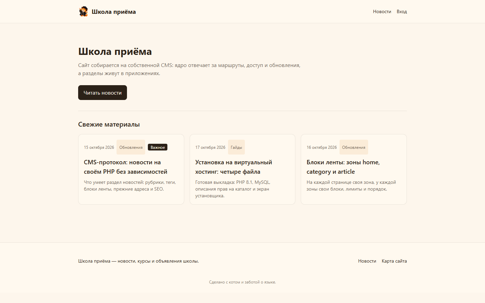
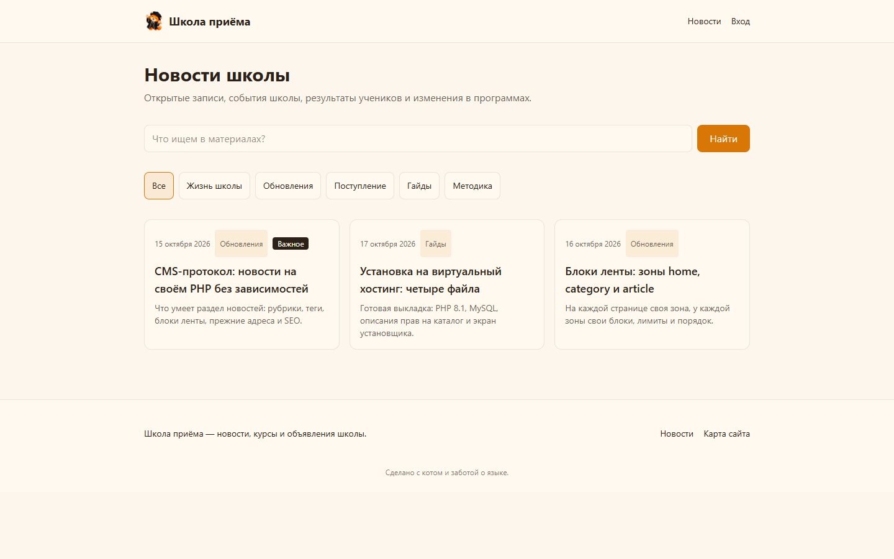
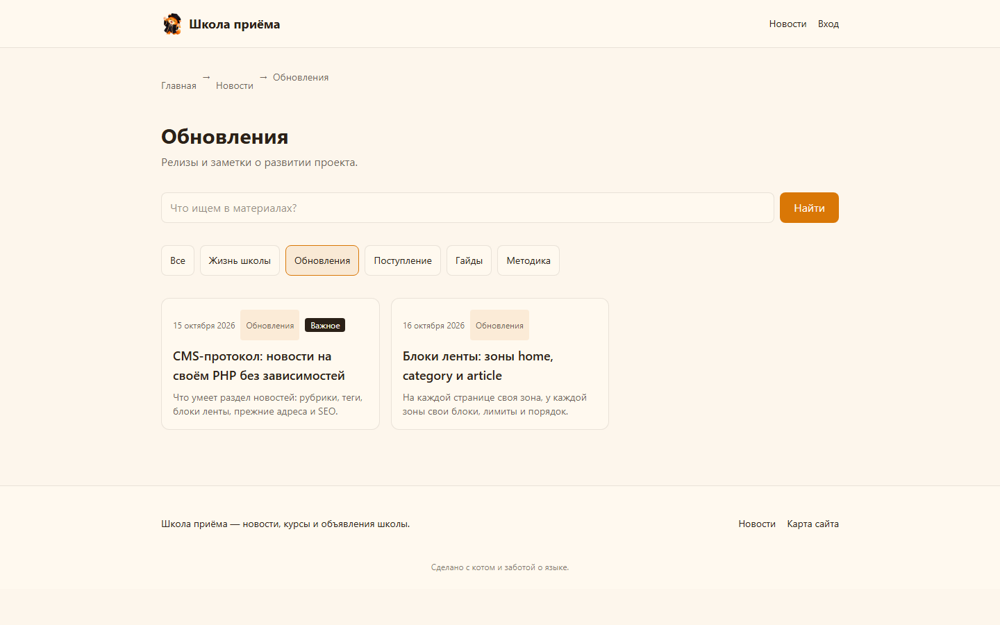
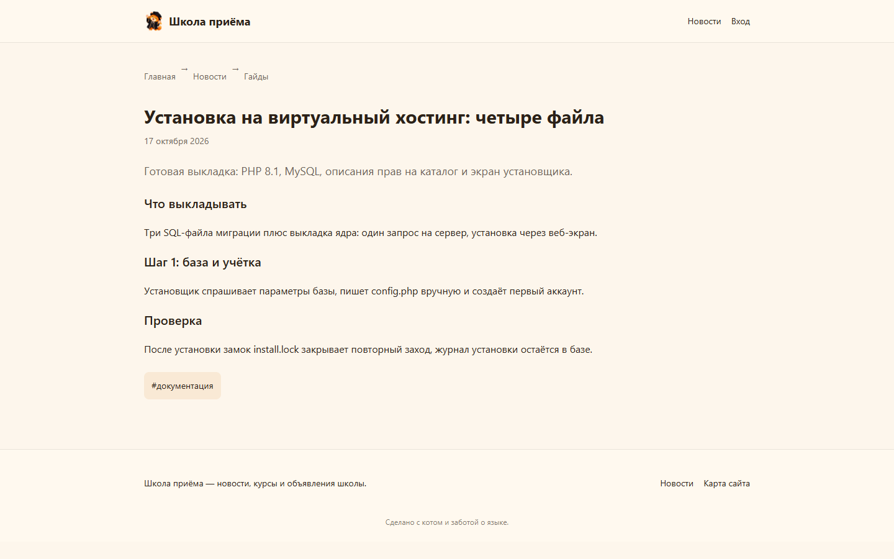
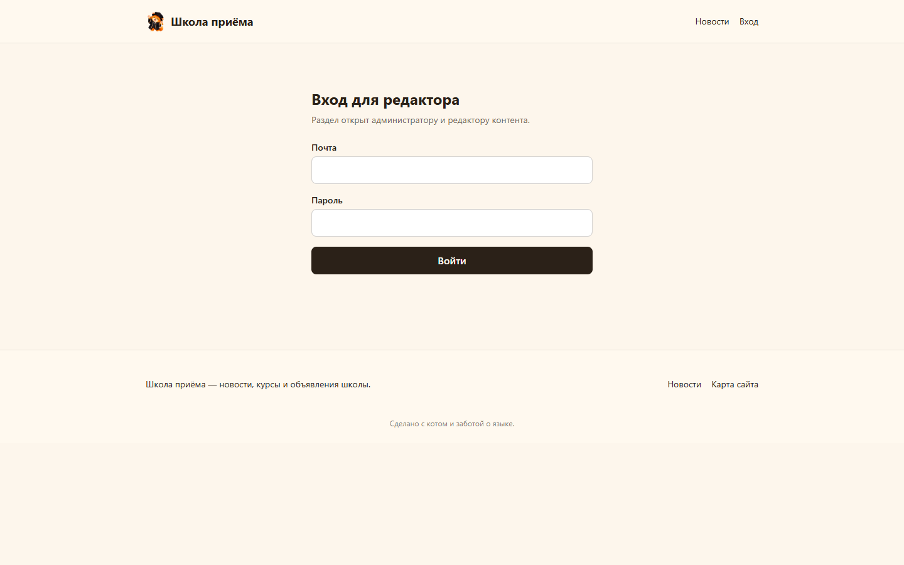

# CMS-протокол

Сайт со встроенной CMS на PHP и MySQL: ядро отвечает за маршруты, доступ, шаблоны и обновления, а
разделы живут в приложениях. В базовой сборке — раздел новостей с лентой, рубриками, тегами и
настраиваемыми блоками. Ядро не требует Composer-зависимостей: выкладка — это файлы плюс SQL-миграции.
Разметка собирается из проверенных значений, сырой HTML не попадает в ответы.

## Скриншоты

Dev-стенд (docker compose, сайт `http://localhost:8080`):

| Страница | Скриншот |
| --- | --- |
| Главная с лентой материалов |  |
| Лента новостей с поиском и рубриками |  |
| Рубрика «Обновления» |  |
| Материал с абзацами, тегом и похожими материалами |  |
| Форма входа для редактора |  |

## Возможности

- Ядро: маршрутизация со статичными путями раньше параметрических, роли администратора и редактора,
  шаблоны с одной точкой печати обёртки страницы.
- Раздел новостей: рубрики и теги, материал в виде массива абзацев, выделение звёздочками, прежние адреса,
  SEO-поля (заголовок, описание, og-картинка, noindex), поиск по материалам.
- Блоки ленты: зоны `home`, `category` и `article`; блок задают отбор (рубрика, тег или весь раздел),
  лимит зоны и порядок внутри зоны; связанная лента печатается только на странице материала.
- Раздел «SEO и статистика»: метаданные, разметка, журнал 404, аудит, цели и конверсии, отчёты,
  ручной счётчик, экспорт CSV/XLSX и машинное чтение отчётов по API-ключам. Что именно собирается,
  чего не собирается и как это устроено — `docs/seo-analytics.md`.
- Страницы: `sitemap.xml`, `robots.txt`, карта сайта.
- Установщик: веб-экран собирает параметры базы, пишет `config.php`, создаёт первый аккаунт и замок
  `install.lock`; журнал установки остаётся в базе.
- Dev-окружение: PHP, MySQL и Mailpit в docker compose; письма собираются в локальном ящике Mailpit.

## Структура каталогов

```
core/       ядро: маршруты, доступ, шаблоны, журнал, конфигурация
apps/news/  раздел новостей: маршруты, контроллеры действий, lib, SQL-миграции, шаблоны
theme/      тема сайта: публичные страницы и обёртка разметки
public/     точка входа и установщик
sql/        миграции ядра
tests/      unit, db, guard (стражи кода), http (прогоны сервера)
docs/       инструкции по выкладке, скриншоты
scripts/    ворота качества и сборка стилей
```

## Быстрый старт

```bash
docker compose -f docker-compose.dev.yml up -d
# сайт: http://localhost:8080, Mailpit: http://localhost:8025
```

Тесты и проверки (то, что гоняет `scripts/gate.sh`):

```bash
docker compose -f docker-compose.dev.yml run --rm -T php vendor/bin/phpunit   # весь набор
bash scripts/gate.sh   # свежесть стилей, php -l, phpstan, php-cs-fixer, phpunit
bash scripts/css       # пересборка public/assets/app.css из src-css/app.css
```

## Установка на виртуальный хостинг

Пошаговая инструкция с готовой выкладкой: `docs/deploy-virtual-hosting/index.html`, короткий чек-лист:
`docs/deploy-checklist.md`. Схема: одна выкладка ядра плюс три SQL-файла миграций, затем экран
установщика в браузере.

## Качество

- PHPUnit: unit, db, guard и http наборы; стражи кода (`tests/guard`) проверяют правила, которые
  компилятор не видит: покрытие CSRF, защита SQL, правила выкладки, запрет сырого HTML.
- PHPStan на максимальном уровне без ошибок, PHP-CS-Fixer в чистом прогоне.
- Правила разработки и дисциплина коммитов описаны в `AGENTS.md`.
