# CMS-протокол

Сайт со встроенной CMS на PHP и MySQL без Composer-зависимостей: ядро отвечает за маршруты,
доступ, шаблоны, установку и обновления, а разделы живут в приложениях и подключаются одним
файлом манифеста. Выкладка — это файлы плюс SQL-миграции; разметка собирается из проверенных
значений, сырой HTML в ответы не попадает. В базовой сборке — четыре раздела: новости,
интернет-магазин, доска объявлений и SEO-аналитика с собственным счётчиком посещений.

## Скриншоты

Экраны сняты на dev-стенде (docker compose, `http://localhost:8080`) с демо-данными,
вьюпорт 1440×900, полные страницы.

Публичная часть:

| Экран | Скриншот |
| --- | --- |
| Главная с лентой свежих материалов |  |
| Лента новостей с поиском и рубриками |  |
| Материал с абзацами, тегами и похожими записями |  |
| Вход для редактора |  |
| Каталог магазина с промо-ценами и остатками | 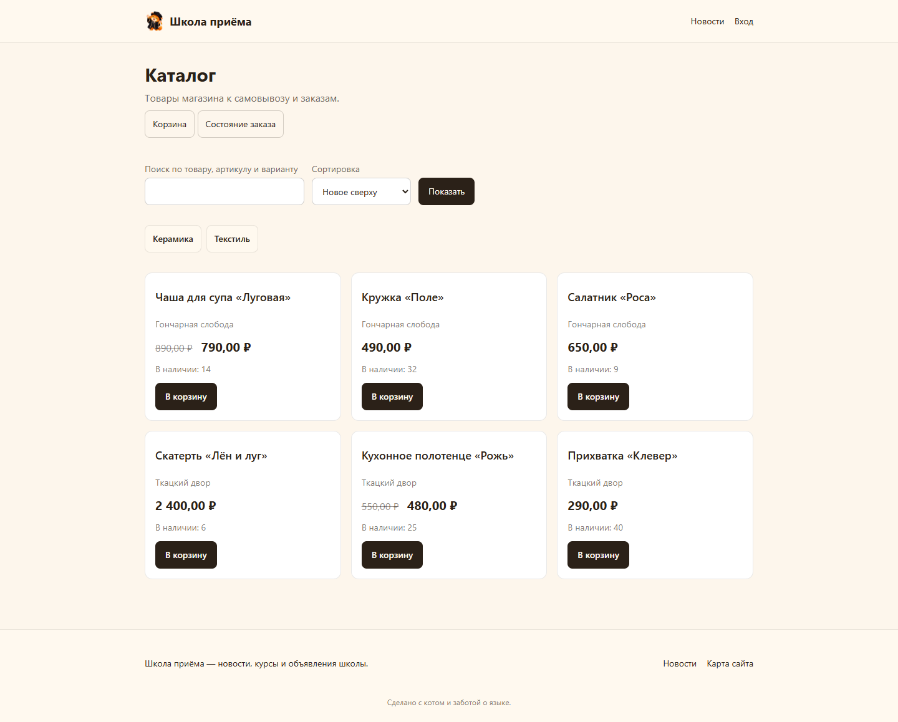 |
| Рубрика магазина | 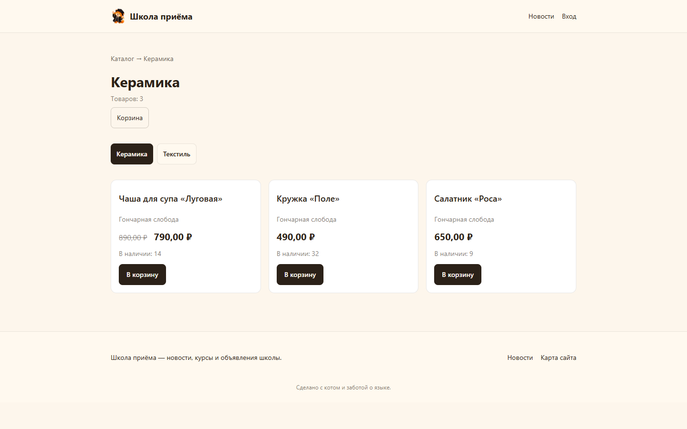 |
| Карточка товара после добавления в корзину | 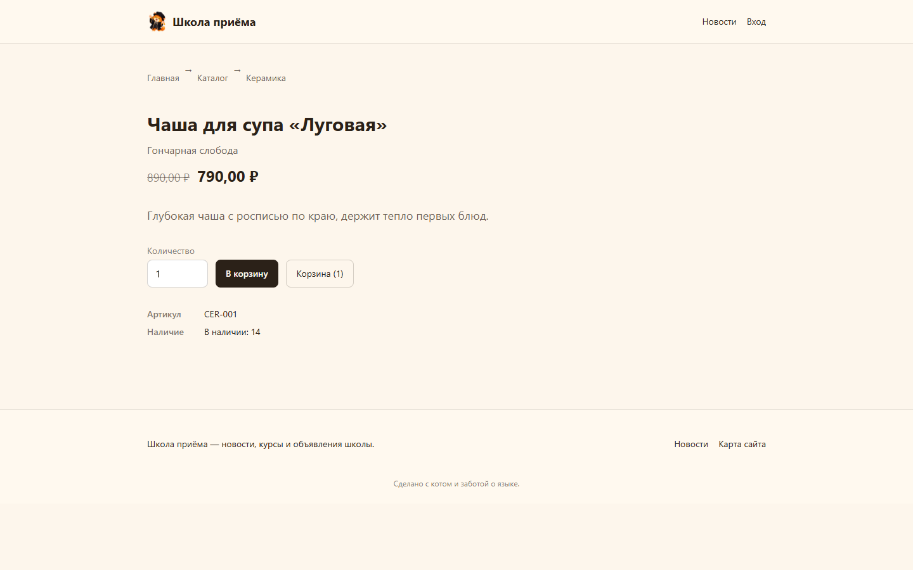 |
| Корзина с купоном и оформлением заказа | 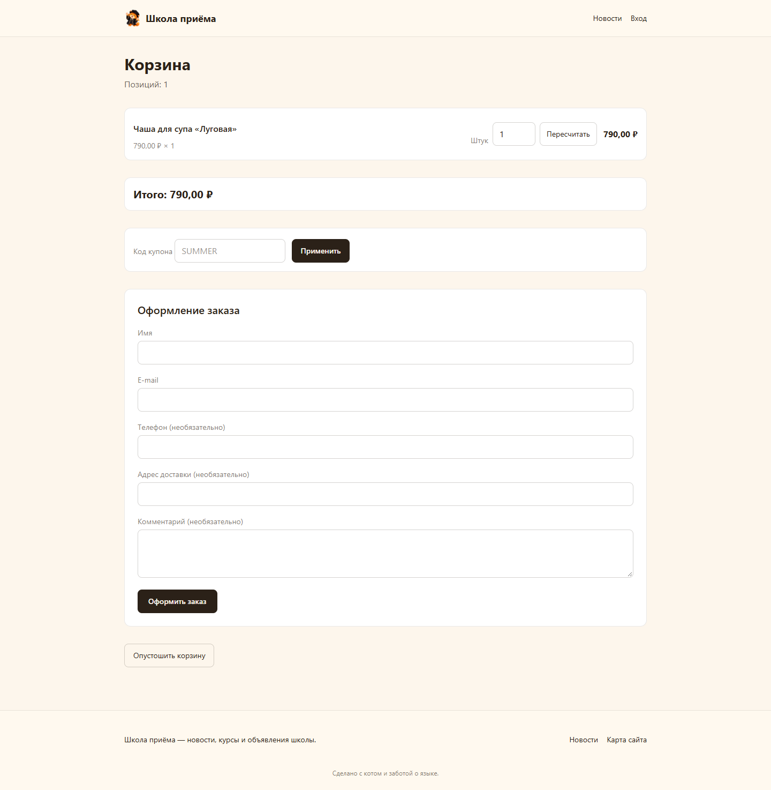 |
| Доска объявлений с поиском и категориями | 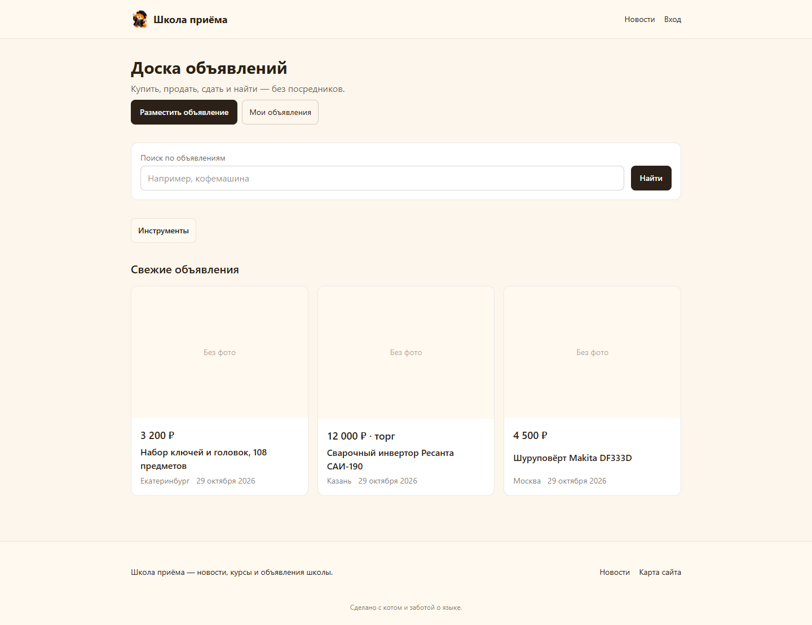 |
| Карточка объявления | 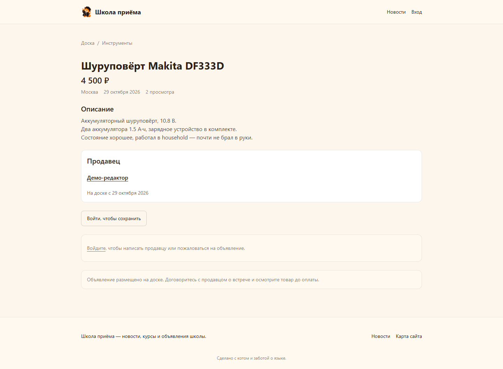 |

Админка (единая навигация «Сводка · Приложения · разделы»):

| Экран | Скриншот |
| --- | --- |
| Сводка ядра: сайт, приложения, версии, плашка версии PHP | 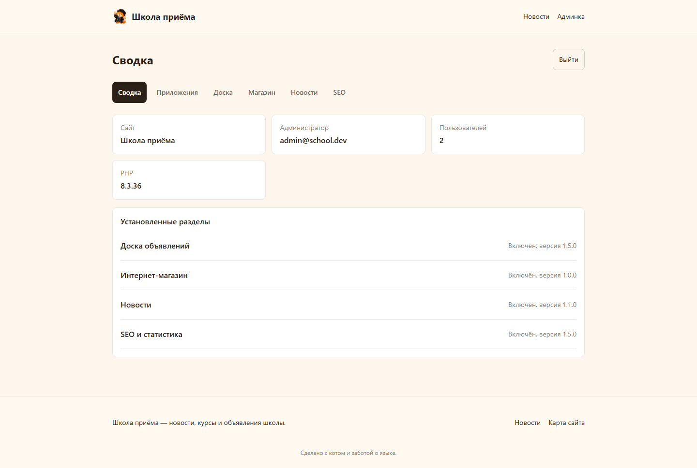 |
| Новости: материалы, фильтры и действия над записью | 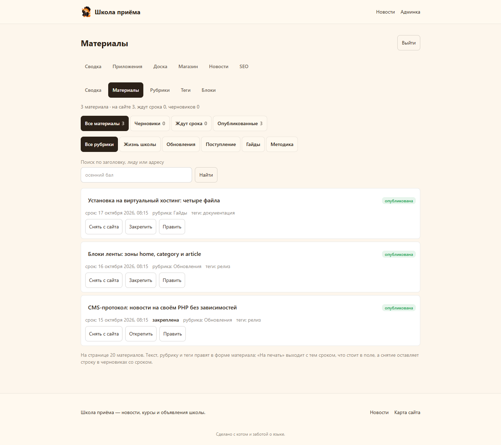 |
| Магазин: обзор с товарами, рубриками и заказами | 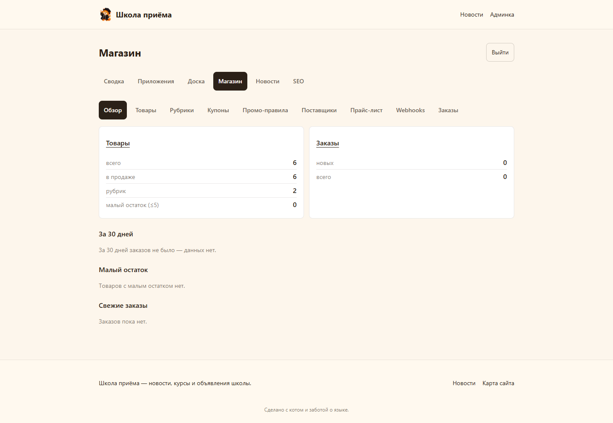 |
| Доска: обзор с категориями, проверкой и жалобами | 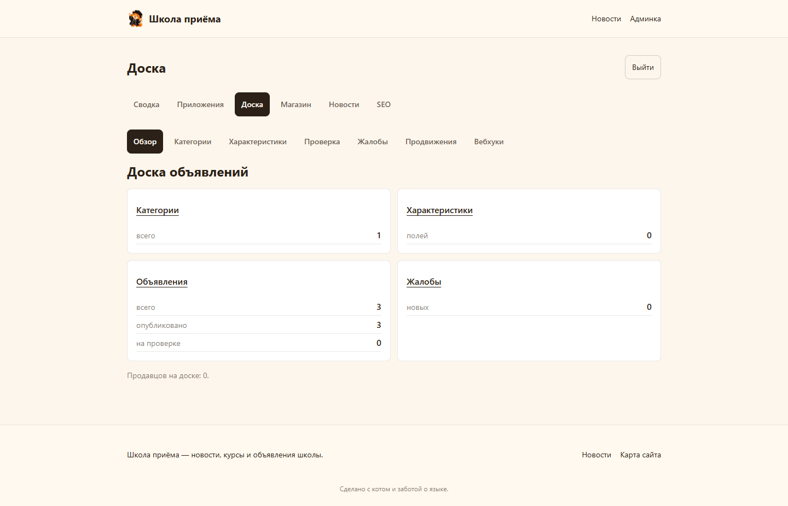 |
| SEO: обзор статистики, просмотры по дням, источники | 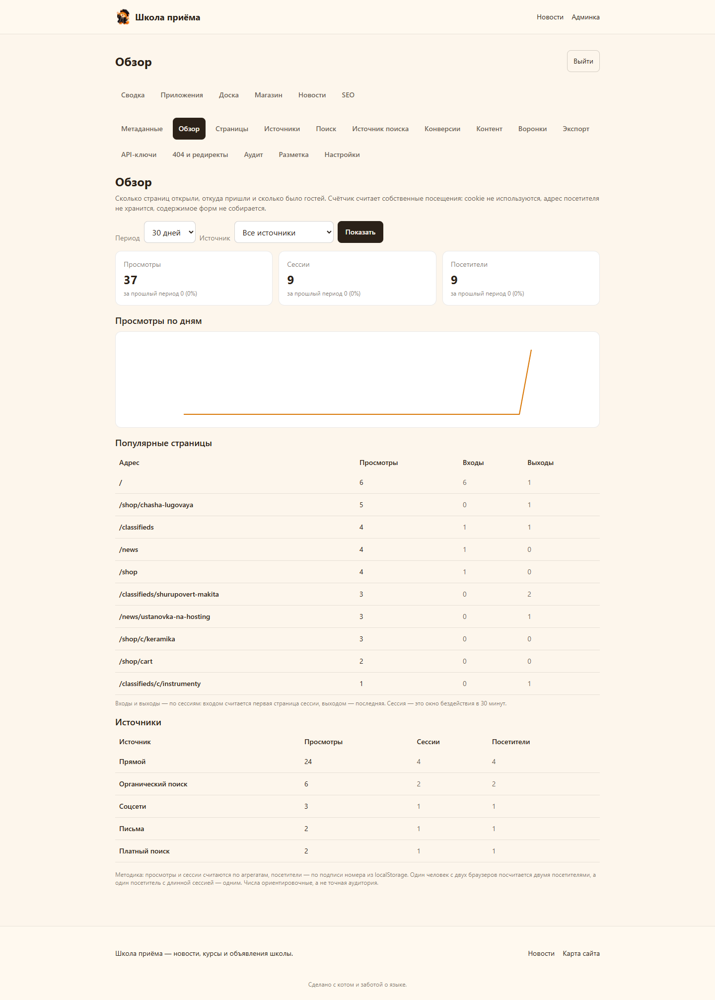 |

## Разделы

- **Ядро** (`core/`): маршрутизация со статичными путями раньше параметрических, роли
  администратора и редактора, сессии и CSRF, шаблоны с одной точкой печати обёртки страницы,
  журнал, конфигурация. Веб-установщик собирает параметры базы, пишет `config.php` с правами
  `600`, создаёт первого администратора и замок `install.lock`; повторный заход отвечает 404.
  Приложения устанавливаются и обновляются из админки: манифест объявляет версию и требуемую
  версию ядра, миграции применяются по журналу. Плюс `sitemap.xml`, `robots.txt`, карта сайта,
  проверка версии PHP против списка безопасных (плашка в сводке).
- **Новости** (`apps/news/`): рубрики и теги, материал в виде массива абзацев с выделением
  звёздочками, поиск с экранированием `%` и `_`, закрепление в ленте, черновики и отложенная
  публикация по сроку, SEO-поля (заголовок, описание, og-картинка, noindex), прежние адреса
  отвечают 301 (история до 10 адресов). Блоки ленты живут в зонах `home`, `category` и `article`:
  блок задаётся отбором (рубрика, тег или весь раздел), лимитом и порядком.
- **Интернет-магазин** (`apps/commerce/`): каталог с рубриками, товары с артикулом, брендом,
  штрихкодом, вариантами и характеристиками; розничная, промо и себестоимость; остатки на складе.
  Корзина с купонами и промо-правилами, оформление заказа, заказы, поставщики, прайс-лист,
  вебхуки на события каталога и заказов.
- **Доска объявлений** (`apps/classifieds/`): дерево категорий, объявления с ценой, пометкой
  «торг» и городом, характеристики категорий, избранное, переписка покупателей с продавцом,
  профиль продавца. Модерация объявлений с проверкой, жалобы, продвижения, уведомления,
  вебхуки и контроль попыток регистрации.
- **SEO и статистика** (`apps/seo/`): собственный счётчик посещений — cookie не используются,
  адрес посетителя не хранится, содержимое форм не собирается. Обзоры по дням и часам,
  страницы, источники, загрузка строк из Google Search Console, конверсии, цели и воронки,
  метаданные страниц, разметка schema.org, журнал 404 и редиректы, аудит, экспорт CSV/XLSX
  и машинное чтение отчётов по API-ключам. Что именно собирается и почему — `docs/seo-analytics.md`.

## Быстрый старт

```bash
docker compose -f docker-compose.dev.yml up -d
# сайт: http://localhost:8080 (при первом открытии — веб-установщик)
# Mailpit (ящик писем): http://localhost:8025
```

Стенд: PHP 8.3, MySQL и Mailpit в контейнерах; все порты открыты только на loopback.
Установщик создаст `config.php`, схему ядра и администратора; разделы ставятся в
`/admin/apps` одним кликом.

Тесты и проверки (то, что гоняет `scripts/gate.sh`):

```bash
docker compose -f docker-compose.dev.yml run --rm -T php vendor/bin/phpunit   # весь набор
bash scripts/gate.sh   # свежесть стилей, php -l, phpstan, php-cs-fixer, phpunit
bash scripts/css       # пересборка public/assets/app.css из src-css/app.css
npm run responsive     # проверка адаптивности 360…1440 в headless Chrome
```

## Установка на виртуальный хостинг

Пошаговая инструкция с готовой выкладкой: `docs/deploy-virtual-hosting/index.html`, короткий
чек-лист: `docs/deploy-checklist.md`. Схема: зонд хостинга, перенос документ-корня, одна
выкладка файлов, затем установщик в браузере и установка разделов из админки.

## Структура каталогов

```
core/              ядро: маршруты, доступ, шаблоны, журнал, конфигурация, обновления
apps/news/         новости: маршруты, контроллеры действий, lib, SQL-миграции, шаблоны
apps/commerce/     интернет-магазин
apps/classifieds/  доска объявлений
apps/seo/          SEO и статистика
theme/             тема сайта: публичные страницы и обёртка разметки
public/            точка входа, установщик, uploads
sql/               миграции ядра
tests/             unit, db, guard (стражи кода), http (прогоны сервера)
docs/              инструкции по выкладке, аналитика SEO, скриншоты
scripts/           ворота качества, сборка стилей, выкладка, проверка адаптивности
```

## Качество

- PHPUnit: unit, db, guard и http наборы. Стражи кода (`tests/guard`) проверяют правила,
  которые компилятор не видит: покрытие CSRF, защита SQL, правила выкладки, запрет сырого HTML.
- PHPStan на максимальном уровне без ошибок, PHP-CS-Fixer в чистом прогоне.
- Все формы работают без JavaScript; админка и публичная часть сверены на экранах 360…1440.
- Правила разработки и дисциплина коммитов описаны в `AGENTS.md`.
